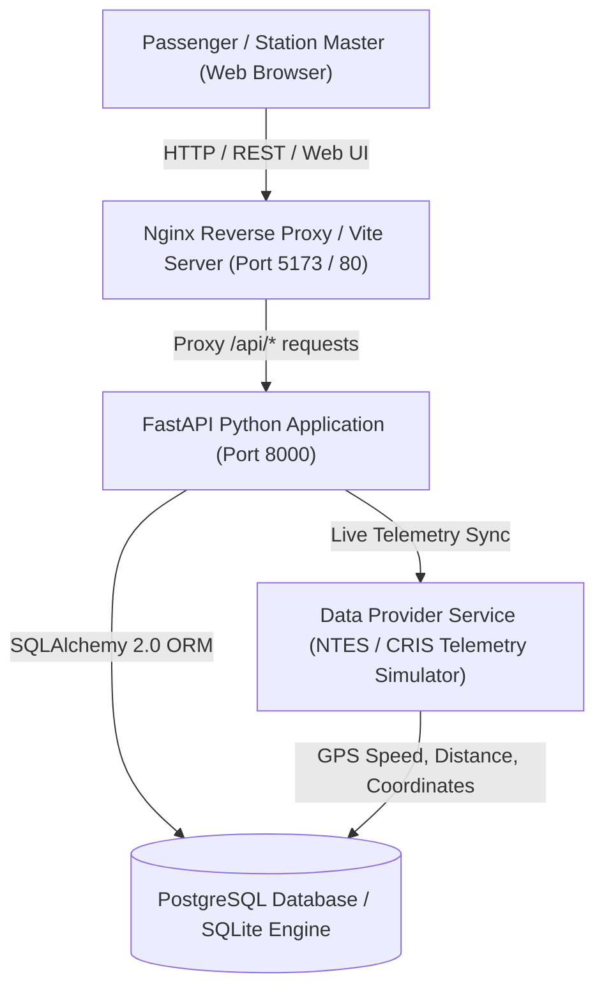

# RailTrack India - National Train Tracking & Railway Information Platform

A full-stack Indian Railways information and train tracking web application. Built with **FastAPI (Python)**, **React 18 (TypeScript)**, **Tailwind CSS**, **SQLAlchemy ORM**, **PostgreSQL / SQLite**, **Leaflet + OpenStreetMap**, and **Recharts**.

---

## 🚆 System Architecture



---

## ✨ Features & Pages

| # | Page | Route | Description |
|---|---|---|---|
| 1 | **Home Dashboard** | `/` | National railway portal, live search, telemetry ticker, and featured premier trains (Vande Bharat, Shatabdi, Rajdhani). |
| 2 | **Train Search** | `/train-search` | Advanced multi-filter search by train number, name, category, source/dest station code, operating days, and departure time. |
| 3 | **Live Train Status** | `/live-status/:trainNumber` | Real-time GPS location, delay in minutes, speed, distance covered/remaining, progress percentage, and verified badge. |
| 4 | **Train Route Details** | `/train-route` | Route alignment timeline, halt durations, distance between stations, day numbers, verified platform assignments, and Leaflet route polyline. |
| 5 | **Station Directory** | `/stations` | Autocomplete station search, categorized by Railway Zone (NR, WR, CR, SR, ER, etc.) and State. |
| 6 | **Station Details & Live Board** | `/stations/:code` | Live arrival/departure departures board, stopping trains schedule, and verified platform facilities (escalators, lifts, accessibility). |
| 7 | **Train Timetable** | `/timetable` | Master grid timetable across trunk routes with day filter and direct route navigation. |
| 8 | **Train Comparison** | `/comparison` | Side-by-side comparison matrix of 2 to 4 trains evaluating duration, halts, speeds, punctuality ratings, and typical delay. |
| 9 | **National Rail Map** | `/railway-map` | Full interactive Leaflet map of India featuring junctions, active trunk corridors, and live rolling stock. |
| 10 | **Login & Registration** | `/login` & `/register` | JWT token authentication with bcrypt password hashing and 1-click quick-fill demo accounts. |
| 11 | **User Profile** | `/profile` | Saved favourite trains and stations, personalized history, and alert settings. |
| 12 | **Admin Operations** | `/admin` | Fleet management, CSV batch timetable ingestion, data source verified toggling, and audit log trail. |
| 13 | **System & API Health** | `/system-status` | Operational status, database health, uptime counter, data providers list, and OpenAPI / Swagger links. |

---

## 🛠️ Technology Stack

- **Frontend**: React 18 + TypeScript + Vite
- **Styling**: Tailwind CSS + Lucide Icons
- **Mapping**: Leaflet 1.9 + OpenStreetMap Carto
- **Charts**: Recharts
- **Backend**: Python 3.11+ / 3.14 FastAPI
- **Database**: PostgreSQL (Docker / Production) with local SQLite automatic fallback
- **ORM & Migrations**: SQLAlchemy 2.0 + Alembic
- **Authentication**: JWT (JSON Web Tokens) + Bcrypt
- **Testing**: Pytest + Pytest-Asyncio + HTTPX

---

## 🗄️ Database Schema

The database consists of 12 relational tables:
1. `trains`: Train number, name, category, origin, destination, operating days, speed, punctuality rating.
2. `stations`: Code (e.g. NDLS), name, hindi name, zone, division, state, coordinates, platform count.
3. `station_platforms`: Platform numbers, length, escalator flag, elevator flag, accessibility flag.
4. `train_routes`: Route identifiers and stop sequence hierarchies.
5. `train_stops`: Intermediate halts, scheduled arrival, scheduled departure, halt duration, distance from origin.
6. `train_schedules`: Day-of-week active operating schedules.
7. `train_running_updates`: Real-time telemetry, GPS latitude/longitude, speed, delay in minutes, distance covered/remaining.
8. `users`: Credentials, email, hashed passwords, roles (`user`, `admin`).
9. `favourites`: User saved trains and stations for quick monitoring.
10. `search_history`: Search queries and origin-destination routes searched.
11. `data_sources`: Registry of telemetry providers with `is_live_verified` flag.
12. `audit_logs`: Administrative action records, CSV ingestion tracking, and security logs.

---

## 🚀 Quick Start Guide

### Prerequisites
- Python 3.10+
- Node.js 18+ and npm
- (Optional) Docker and Docker Compose

---

### Option A: Local Development (Windows / macOS / Linux)

#### 1. Backend Setup
```bash
cd backend
python -m venv venv

# Windows:
venv\Scripts\activate
# Linux/macOS:
source venv/bin/activate

pip install -r requirements.txt

# Run database migrations
alembic upgrade head

# Seed initial Indian Railways dataset
python app/data/seed.py

# Start FastAPI server
uvicorn app.main:app --host 127.0.0.1 --port 8000 --reload
```
API Documentation will be live at: `http://127.0.0.1:8000/api/docs`

#### 2. Frontend Setup
```bash
cd frontend
npm install
npm run dev -- --host --port 5173
```
Web application will be live at: `http://localhost:5173/`

---

### Option B: Docker Compose (Full Stack with PostgreSQL)

```bash
docker-compose up --build
```
This spins up:
- `postgres`: PostgreSQL 15 database on port 5432
- `backend`: FastAPI Python service on port 8000 (auto-migrated & seeded)
- `frontend`: React TypeScript production build with Nginx on port 80 / 5173

---

### Option C: Deploy to Vercel (1-Click Ready ⚡)

This repository includes native Vercel configuration (`vercel.json`, `api/index.py`, `package.json`):

1. **Import the repository** on [Vercel](https://vercel.com/new):
   - Select `https://github.com/tirtheshbari18/Indian-Railways-Train-Tracking-Website.git`
2. **Build & Output Settings**:
   - Vercel automatically detects `vercel.json`.
   - Build Command: `cd frontend && npm install && npm run build`
   - Output Directory: `frontend/dist`
   - Python Serverless Function: `api/index.py` handles all `/api/*` endpoints.
3. **Environment Variables (Optional)**:
   - `DATABASE_URL`: Provide your hosted PostgreSQL connection string (Neon, Supabase, Railway, or AWS RDS).
   - If `DATABASE_URL` is omitted, the app automatically runs on SQLite in `/tmp/railway.db` and auto-seeds all Indian Railways data on the first request!
4. Click **Deploy**! Your site is live with full frontend and API functionality.

---

## 🧪 Automated Testing

Run the Pytest suite to verify authentication, train searches, route calculations, live running tracking, and comparisons:

```bash
cd backend
pytest app/tests -v
```

**Test Results:**
```
backend/app/tests/test_auth.py::test_register_and_login PASSED           [ 10%]
backend/app/tests/test_auth.py::test_login_invalid_password PASSED       [ 20%]
backend/app/tests/test_comparison.py::test_train_comparison PASSED       [ 30%]
backend/app/tests/test_comparison.py::test_train_comparison_invalid_count PASSED [ 40%]
backend/app/tests/test_live_status.py::test_live_running_status PASSED   [ 50%]
backend/app/tests/test_live_status.py::test_live_status_nonexistent_train PASSED [ 60%]
backend/app/tests/test_stations.py::test_search_and_autocomplete_stations PASSED [ 70%]
backend/app/tests/test_trains.py::test_search_trains PASSED              [ 80%]
backend/app/tests/test_trains.py::test_get_train_details PASSED          [ 90%]
backend/app/tests/test_trains.py::test_get_train_route PASSED            [100%]

======================= 10 passed in 5.80s =======================
```

---

## 🔑 Demo Credentials

| Role | Email | Password | Permissions |
|---|---|---|---|
| **System Admin** | `admin@railtrack.gov.in` | `admin123` | Full admin dashboard, CSV import, data source mode toggling, audit logs. |
| **Passenger User** | `passenger@railtrack.gov.in` | `passenger123` | Favourites management, search history, preferences. |

*Quick-fill demo buttons are provided on the login page.*

---

## 📡 Live Telemetry & Verification Policy

Per Indian Railway information systems specifications:
- **`LIVE VERIFIED` Badge**: Shown with a pulsing green radar indicator **only** when an authorized, live telemetry feed is connected and current data has been verified.
- **`DEMO DATA / SIMULATION` Badge**: Displayed with an amber warning badge when mock telemetry or continuous movement simulations are active.
- **`SCHEDULED INFORMATION` Badge**: Displayed when projection is derived purely from published timetable schedules.

---

## 📄 License & Attribution
Designed for educational, operational, and tracking systems demonstrative purposes adhering to Indian Railways information formatting guidelines.
